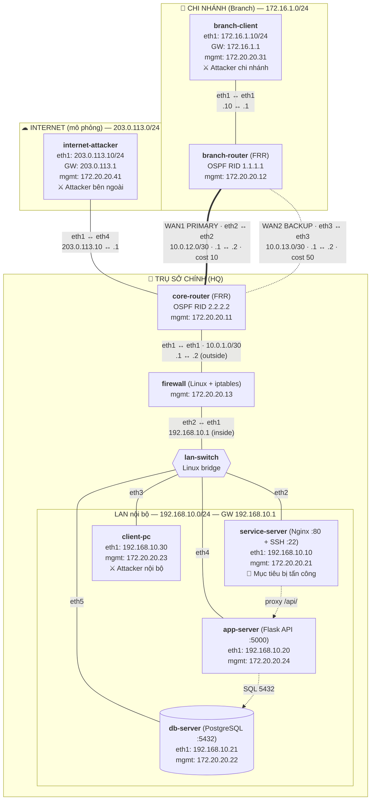
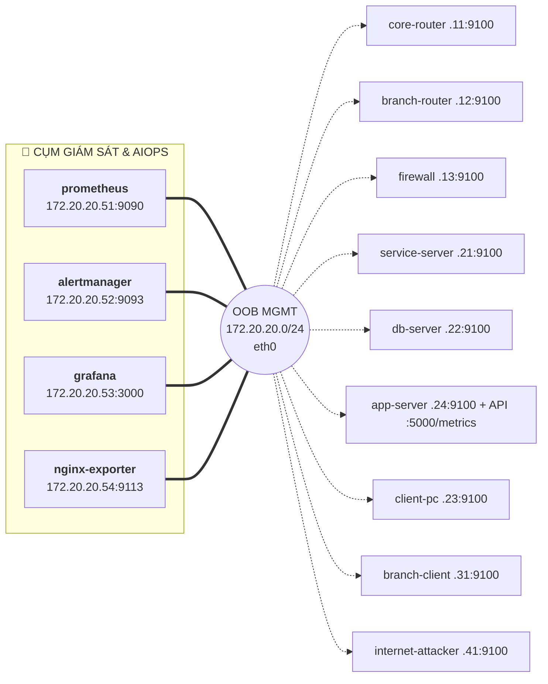

# Thiết kế mạng – AIOps Lab

> **Đề tài:** Nghiên cứu và xây dựng hệ thống giám sát, phát hiện bất thường và tự động ứng phó sự cố mạng dựa trên AIOps
> **Nền tảng:** Ubuntu Linux · Containerlab · FRRouting · Alpine Linux · Nginx · Prometheus · Grafana
> **File liên quan:** [`topo.yml`](../topo.yml) · [`config/`](../config) · [`monitoring/`](../monitoring) · [`scripts/`](../scripts)

---

## 1. Sơ đồ tổng quan



**Mạng quản lý out-of-band (OOB):** mọi node có thêm cổng `eth0` nối vào `172.20.20.0/24` (Docker network `clab`, gateway `172.20.20.1`). Cụm AIOps hoạt động độc lập trên mạng OOB này.



> **Vì sao cần OOB?** Metric được thu qua `eth0`, tách biệt hoàn toàn với mạng dữ liệu. Khi mô phỏng DDoS hay đứt link WAN, hệ thống giám sát và module tự động phản ứng **vẫn sống sót và hoạt động liên tục**. Đây là nguyên lý chuẩn trong kiến trúc NOC/SOC thực tế.

---

## 2. Quy hoạch dải địa chỉ

| Dải mạng | Vai trò | Ghi chú |
|---|---|---|
| `172.16.1.0/24` | LAN chi nhánh | Branch Router làm gateway |
| `10.0.12.0/30` | WAN1 – Primary | OSPF cost 10 |
| `10.0.13.0/30` | WAN2 – Backup | OSPF cost 50 |
| `10.0.1.0/30` | Core ↔ Firewall (outside) | Point-to-point |
| `192.168.10.0/24` | LAN trụ sở (inside) | Firewall làm gateway |
| `203.0.113.0/24` | Internet mô phỏng | TEST-NET-3 (RFC 5737), dải dành cho tài liệu |
| `172.20.20.0/24` | Quản lý OOB | Containerlab tạo, gateway `.1` |

---

## 3. Bảng IP chi tiết theo thiết bị

### 3.1 Core Router: `core-router` (FRR, OSPF RID `2.2.2.2`)
| Cổng | IP | Nối tới | Ghi chú |
|---|---|---|---|
| eth0 | 172.20.20.11/24 | OOB | Quản lý, node_exporter:9100 |
| eth1 | 10.0.1.1/30 | firewall eth1 | OSPF passive |
| eth2 | 10.0.12.2/30 | branch-router eth2 | **WAN1 Primary**, cost 10 |
| eth3 | 10.0.13.2/30 | branch-router eth3 | **WAN2 Backup**, cost 50 |
| eth4 | 203.0.113.1/24 | internet-attacker eth1 | Internet, OSPF passive |

Static route: `192.168.10.0/24 → 10.0.1.2`, được `redistribute static` vào OSPF.

### 3.2 Branch Router: `branch-router` (FRR, OSPF RID `1.1.1.1`)
| Cổng | IP | Nối tới | Ghi chú |
|---|---|---|---|
| eth0 | 172.20.20.12/24 | OOB | Quản lý, node_exporter:9100 |
| eth1 | 172.16.1.1/24 | branch-client eth1 | Gateway chi nhánh, OSPF passive |
| eth2 | 10.0.12.1/30 | core-router eth2 | **WAN1 Primary**, cost 10 |
| eth3 | 10.0.13.1/30 | core-router eth3 | **WAN2 Backup**, cost 50 |

### 3.3 Firewall: `firewall` (Alpine + iptables)
| Cổng | IP | Nối tới | Ghi chú |
|---|---|---|---|
| eth0 | 172.20.20.13/24 | OOB | Quản lý, node_exporter:9100 |
| eth1 | 10.0.1.2/30 | core-router eth1 | **Outside** |
| eth2 | 192.168.10.1/24 | lan-switch eth1 | **Inside**, gateway LAN |

Route tĩnh: `172.16.1.0/24`, `10.0.0.0/16` và `203.0.113.0/24` đều đi qua `10.0.1.1`.

### 3.4 LAN Switch: `lan-switch` (Linux bridge trên host)
| Cổng | Nối tới |
|---|---|
| eth1 | firewall eth2 |
| eth2 | service-server eth1 |
| eth3 | client-pc eth1 |
| eth4 | app-server eth1 |
| eth5 | db-server eth1 |

### 3.5 Các host dữ liệu & Attacker
| Node | Data IP (eth1) | Gateway dữ liệu | Mgmt IP (eth0) | Vai trò |
|---|---|---|---|---|
| service-server | 192.168.10.10/24 | 192.168.10.1 | 172.20.20.21 | 🎯 Nginx (web + reverse proxy `/api/`) + SSH, mục tiêu tấn công. Dịch vụ nhẹ sau này (DNS...) gộp vào node này |
| app-server | 192.168.10.20/24 | 192.168.10.1 | 172.20.20.24 | Flask API :5000, xuất metrics `/metrics` |
| db-server | 192.168.10.21/24 | 192.168.10.1 | 172.20.20.22 | PostgreSQL 16 :5432 (db `corp`) |
| client-pc | 192.168.10.30/24 | 192.168.10.1 | 172.20.20.23 | 👤 Người dùng LAN / ⚔ attacker nội bộ |
| branch-client | 172.16.1.10/24 | 172.16.1.1 | 172.20.20.31 | 👤 Sinh tải / ⚔ attacker chi nhánh |
| internet-attacker | 203.0.113.10/24 | 203.0.113.1 | 172.20.20.41 | ⚔ Attacker từ Internet |

### 3.6 Cụm Giám sát & AIOps (Mạng OOB)
| Node | Image | Mgmt IP (eth0) | Cổng Host | Vai trò |
|---|---|---|---|---|
| prometheus | prom/prometheus:latest | 172.20.20.51 | 9090 | Thu thập time-series metrics mỗi 5s, đánh giá alert rules |
| alertmanager | prom/alertmanager:latest | 172.20.20.52 | 9093 | Gom nhóm cảnh báo, định tuyến webhook tự động phản ứng |
| grafana | grafana/grafana:latest | 172.20.20.53 | 3000 | Dashboard trực quan hóa băng thông WAN, CPU, rớt gói, tấn công |
| nginx-exporter | nginx/nginx-prometheus-exporter | 172.20.20.54 | 9113 | Đọc `/stub_status` của service-server, xuất metrics Nginx |

### 3.7 Kiến trúc ứng dụng 3 tầng
`client → service-server (Nginx) → app-server (Flask) → db-server (PostgreSQL)`. Mỗi tầng xuất metrics riêng (Nginx: stub_status; API: độ trễ, tỷ lệ lỗi, lỗi DB; DB: node_exporter), nên sự cố ở tầng dưới thể hiện được sự lan truyền lên tầng trên.

---

## 4. Định tuyến

- **OSPF area 0** giữa Branch và Core qua 2 đường WAN.
  - WAN1 (cost 10) là đường chính. WAN2 (cost 50) chỉ được dùng khi WAN1 đứt, nên kịch bản **failover** sẽ diễn ra như vậy.
  - 2 link WAN đặt `ip ospf network point-to-point`: không bầu DR/BDR, nên khi WAN1 có lại thì hội tụ khoảng **1s** (kiểu broadcast mặc định mất khoảng 40s).
  - Các cổng không nối router (eth1 của Branch; eth1, eth4 của Core) đặt **passive**, tức là vẫn quảng bá dải mạng nhưng không gửi Hello ra ngoài.
- **Core** quảng bá dải LAN `192.168.10.0/24` (route tĩnh về Firewall) vào OSPF bằng `redistribute static`.
- **Firewall** không chạy OSPF, chỉ dùng route tĩnh về Core.

### Luồng traffic chính
| Nguồn → Đích | Đường đi |
|---|---|
| Branch Client → Service Server | branch-client → branch-router → **WAN1** → core-router → firewall → lan-switch → service-server |
| Internet → Service Server | internet-attacker → core-router → firewall → lan-switch → service-server |
| Client PC → Service Server | client-pc → lan-switch → service-server (**không qua firewall**) |

---

## 5. Vai trò tấn công và điểm phản ứng

| Hướng tấn công | Node nguồn | Đi qua Firewall? | Điểm chặn tự động |
|---|---|---|---|
| 🌐 Bên ngoài (Internet) | internet-attacker `203.0.113.10` | ✅ Có | iptables trên **firewall** |
| 🏬 Chi nhánh (compromised host) | branch-client `172.16.1.10` | ✅ Có | iptables trên **firewall** |
| 🏠 Nội bộ (insider / lateral) | client-pc `192.168.10.30` | ❌ Không | iptables trên **service-server** hoặc cách ly máy |

Công cụ cài sẵn trên 3 node attacker: `hping3` (flood), `nmap` (quét cổng), `iperf3` (nghẽn băng thông), `curl` (HTTP).

---

## 6. Vận hành

```bash
./scripts/deploy.sh         # Tạo bridge lan-switch + deploy lab & monitoring
./scripts/verify.sh         # Kiểm tra OSPF, ping, HTTP, công cụ, Prometheus, Grafana
./scripts/test-failover.sh  # Demo đứt WAN1 -> chuyển WAN2 -> khôi phục
./scripts/destroy.sh        # Huỷ lab + xoá bridge

# Truy cập dịch vụ
# Grafana Web UI:   http://localhost:3000 (admin / admin)
# Prometheus UI:    http://localhost:9090
# Alertmanager UI:  http://localhost:9093
```
